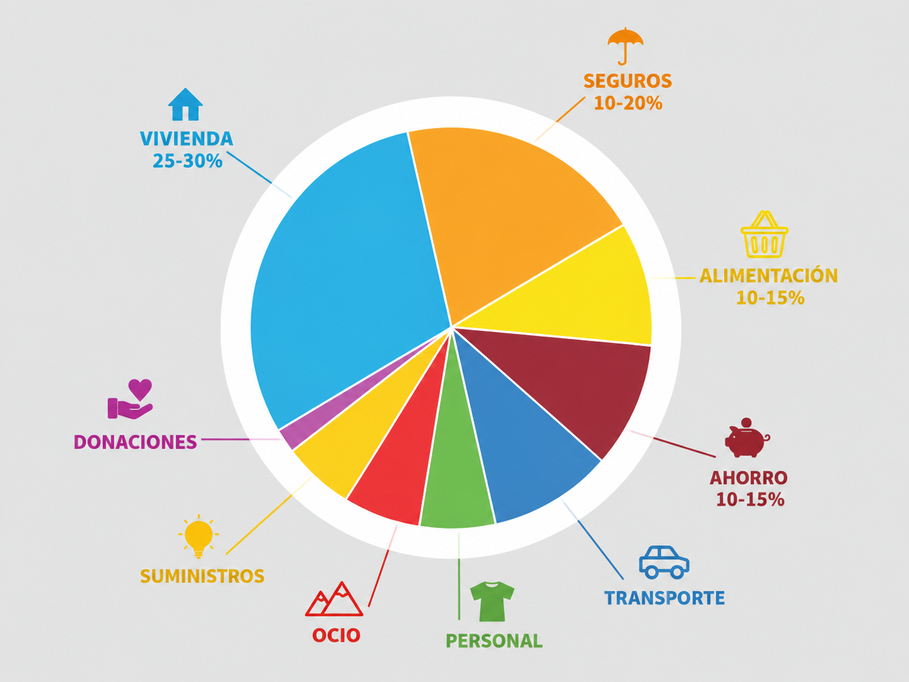
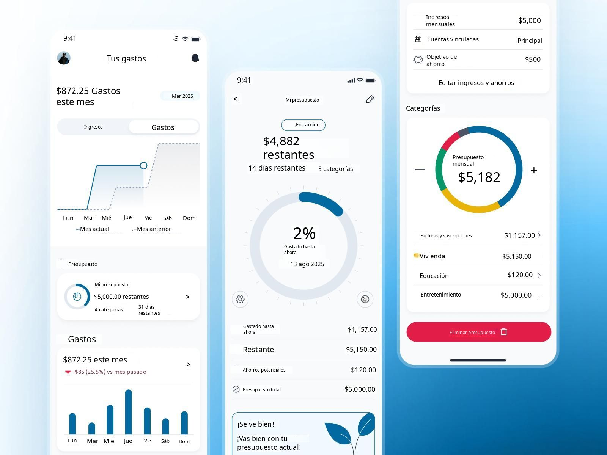

# Título Proyecto

## Miembros del grupo L4-3

1. ALMERO RUIZ, FRANCISCO DE ASÍS
2. GIMENA SALAS, RODRIGO
3. SORIANO RODRIGUEZ, MIGUEL

## 1. Introducción al problema

- Descripción del problema para poner en contexto el proyecto, incluyendo información sobre los clientes y usuarios, la situación actual, problemas, expectativas, etc. Se valorará la presencia de información multimedia (fotos, gráficos, documentos escaneados, etc.).

### Contexto y descripción general

En la actualidad, la gestión de las finanzas personales constituye una actividad importante para personas de diferentes edades y situaciones económicas. Todo tipo de personas necesitan controlar sus ingresos, gastos, ahorros y presupuestos para conocer su situación económica y tomar decisiones financieras adecuadas.

Sin embargo, muchas personas realizan este seguimiento mediante métodos anticuados que no siempre permiten organizar toda su información de manera conjunta. Esta situación dificulta conocer con precisión cuánto dinero tienen disponible, identificar dónde gastan más y comprobar si están cumpliendo sus objetivos de ahorro.

El proyecto propone el diseño de una base de datos relacional en MariaDB que permita centralizar y organizar la información financiera de los usuarios. La base de datos servirá como soporte para una aplicación de gestión de finanzas personales, facilitando el registro y la consulta de cuentas bancarias, transacciones, categorías de ingresos y gastos, métodos de pago y presupuestos.

### Clientes y usuarios

Los principales clientes potenciales del sistema son personas que desean mejorar el control de sus finanzas personales sin necesidad de utilizar herramientas complejas. Entre ellos destacamos los estudiantes universitarios, los trabajadores y las familias que necesitan administrar sus ingresos y gastos habituales.

Los usuarios principales serán las propias personas que utilicen la aplicación para registrar sus movimientos financieros, consultar sus cuentas y analizar sus hábitos de consumo. También podrán establecer presupuestos mensuales por categorías, como alimentación, transporte, vivienda u ocio, con el objetivo de controlar sus gastos.

Además, contemplamos la existencia de un administrador encargado del mantenimiento técnico del sistema y de la gestión de la base de datos. Este perfil no necesita acceder al detalle de las finanzas personales de los usuarios para realizar las tareas técnicas habituales.

### Situación actual

En el presente escenario que pretendemos mejorar, la información económica de una persona puede encontrarse repartida entre distintas cuentas bancarias, aplicaciones móviles, extractos bancarios y hojas de cálculo. Aunque estas herramientas permiten consultar determinados datos, reunir toda la información y obtener una visión global de las finanzas puede requerir tiempo y trabajo manual.

Además, el registro manual de las operaciones puede provocar errores, duplicidades u omisiones. La ausencia de una clasificación homogénea de los movimientos también dificulta comparar los gastos de distintos meses o identificar cambios en los hábitos de consumo.

<figure>
  
  <figcaption>Figura 1. Situación actual de la gestión financiera.</figcaption>
</figure>

### Problemas detectados

Los principales problemas que pretendemos abordar son:

- Información dispersa: los movimientos y saldos se consultan en diferentes fuentes, lo que dificulta obtener una visión conjunta.

- Errores de registro: la introducción manual de datos puede provocar importes incorrectos, transacciones duplicadas u operaciones olvidadas.

- Falta de clasificación: si los ingresos y gastos no se organizan por categorías, resulta más difícil analizar cómo se utiliza el dinero.

- Control presupuestario limitado: sin un seguimiento periódico, el usuario puede superar el gasto que había previsto para determinadas categorías.

- Dificultad para analizar la evolución económica: comparar ingresos, gastos y ahorros entre distintos periodos puede resultar laborioso.

- Dificultad para obtener información útil: la ausencia de consultas estructuradas impide responder fácilmente a preguntas como cuál es la categoría con mayor gasto o cuánto se ha ahorrado durante un mes.

### Expectativas

Queremos hacer que los usuarios dispongan de una herramienta sencilla, organizada y fiable que les permita consultar su información financiera de forma rápida. Para satisfacer estas necesidades, el sistema deberá permitir registrar ingresos y gastos, asociarlos a cuentas y categorías, consultar saldos y analizar movimientos por fechas.

<figure>
  
  <figcaption>Figura 2. Ejemplo de distribución de gastos mensual.</figcaption>
</figure>

Asimismo, esperamos que la aplicación facilite la creación de presupuestos mensuales y la comparación entre los importes previstos y los gastos reales. La información almacenada deberá mantener su integridad y estar protegida frente a accesos no autorizados, especialmente porque se trata de datos económicos personales.

Desde el punto de vista técnico, la base de datos deberá disponer de una estructura relacional coherente, con entidades bien definidas, relaciones entre ellas y restricciones que eviten inconsistencias. También deberá permitir realizar consultas SQL que generen información útil para los usuarios.

<figure>
  
  <figcaption>Figura 3. Ejemplo de solución propuesta.</figcaption>
</figure>

## 2. Glosario de términos

- Términos específicos del dominio del problema, ordenados alfabéticamente. Se valorará la presencia de información multimedia.

## 3. Visión general del sistema

### 3.1. Requisitos generales

### 3.2. Usuarios del sistema

## 4. Catálogo de requisitos

### 4.1. Requisitos funcionales

#### R.F.01. Registrar varias cuentas por usuario

Como cliente,
quiero poder acceder a distintas cuentas bancarias
para poder entrar en ellas en una sola aplicación.

**Prueba de aceptación**
- Dado un usuario, cuando este añade una cuenta bancaria, se añadirá a su lista de cuentas.
- R.N.01: Las cuentas bancarias a añadir en el usuario deben de tener el mismo id de usuario.

#### R.F.02. Consulta de Saldos

Como cliente,
quiero poder consultar mi saldo
para poder ver los ingresos/gastos y planificar mi dinero.

**Prueba de aceptación**
- Dado un saldo, si este es de 1000$ y le llega un gasto de 500$ y un ingreso de 300$, el saldo debe de mostrar un total de 800$.
- Dado un saldo de 1500$, si se trata de realizar un gasto de 2000$, este se rechazará por saldo insuficiente.
- R.N.02: Los ingresos han de ser siempre positivo.
- R.N.03: El saldo no puede ser menor que 0.
- R.N.04: Los gastos han de ser menores que el saldo.

#### R.F.03. Transferencias

Como cliente,
quiero poder realizar transferencias
para poder mover mis saldo a otras cuentas , recibir y dar dinero a otras cuentas.

**Prueba de aceptación**
- Dado dos cuentas A = 500$ y B = 1000$, si se realiza una transferencia de A a B de 200$, las cuentas quedarían con saldos de A = 300$ y B = 1200$.
- Dado dos cuentas A = 500$ y B = 1000$, si se trata de realizar una transferencia de A a B de 700$, este se rechazará por superar el saldo de A, quien emite la transferencia.
- R.N.05: Los importes a transferir no pueden superar al saldo de la cuenta emisora.
- R.N.06: Los importes a transferir no pueden ser negativos.

#### R.F.04. Clasificación

Como cliente,
quiero que mis movimientos estén clasificados según su tipo y categoría (Ocio,Transporte,etc)
para que la búsqueda de saldos sea más fácil y estos estén ordenados.

**Prueba de aceptación**
- Dado un gasto, si este viene con la categoría de "Ocio", este ha de ser guardado bajo la categoría de "Ocio"
- Dado un gasto, si este no viene dado por un tipo, se considerará como "Otro" y se guardará en dicha sección
- Dado un movimiento, si este no viene dado por ningún tipo, se considerará no valido y no cambiará el saldo.
- R.N.07: Los movimientos han de tener un tipo establecido (Gasto o Ingreso)
- R.N.06: Los gastos han de estar guardados en una categoría.

#### R.F.05. Presupuesto

Como cliente,
quiero poder crear y consultar presupuestos
para poder planificar mis movimientos con mayor detenimiento.

**Prueba de aceptación**
- Dado un presupuesto de unos 300$ para marzo bajo la categoria de "Vivienda", si se crea otro en el mismo mes y categoría, se rechazará.
- Dado un presupuesto de unos 1000$ para marzo, si hago gastos de 150$ y 200$ en dicho mes, el gasto real será de unos 350$ y solo se podrá gastar 650$.
- Dado un presupuesto en la categoría "Ocio" para abril, si se crea otro presupuesto de la misma categoría pero de distinto mes, se rechazará dicha creación.
- Dado una categoria de ingresos (Nómina), si el usuario trata de crear un presupuesto en dicha categoria, se rechazará dicha creación.
- R.N.08: Un presupuesto ha de estar ligado a un único usuario, categoría y mes.
- R.N.09: El gasto real ha de ser la suma de todos los gastos de una categoría realizada en un mes.
- R.N.10: Las transferencias a cuentas del mismo usuario no cuentan en el gasto real.
- R.N.11: Solo se pueden presupuestar categorias de gasto.
  

#### 4.1.1. Requisitos de información

##### R.I.01. Usuario:

Como cliente, 
quiero poder registrarme en la plataforma con nombre,
email y fecha de alta.

**Prueba de aceptación**
- Dado un cliente, si se crea una usuario con los datos requeridos, su guardará todos sus datos.
- Dado un cliente, si este crea una nueva usuario con mismo email de otra cuenta, se rechaza.
- Dado un cliente, si al crear una usuario, no se proporciona email, nombre o fecha de alta, se rechaza por falta de datos.

##### R.I.02. Cuentas:

Como cliente,
quiero crear cuentas en mi usuario
para poder gestionarlas todas en una sola aplicación. Dicha cuenta ha de estar definida por su usuario,
nombre, tipo de cuenta, saldo y si esta activa.

**Prueba de aceptación**
- Dado un usuario, si se crea una cuenta con los datos requeridos mas su saldo (supóngase 1000$), su guardará todos sus datos y su saldo inicial.
- Dado un usuario, si se crea una cuenta sin definir la moneda que emplea, se pondrá como defecto el EURO.
- Dado un usuario cuyo id no existe. si trata de crearla, se rechazará.
- Dado un usuario, si se crea una cuenta con saldo negativo, se rechazará.

##### R.I.03. Movimientos:

Como cliente,
quiero poder consultar los movimientos
realizados, quiero en ellas se indiquen su cuenta asociada, categoría, fecha, importe, descripcion, tipo de movimiento (ingreso o gasto) y fecha de creación.

**Prueba de aceptación**
- Dado un movimiento, si este no se indica que tipo de movimiento es, se considerará como inexistente.
- Dado un movimiento, si esta no esta asociada a la cuenta en el que se realizo dicho movimiento, se considerará igualmente inexistente.
- Dado un movimiento, si este posee importe negativo (independientemente si es gasto o ingreso), se considerará no válido.
- Dado un movimiento, si este posee un tipo, cuenta asociada, importe y fecha de creación, se registrará en la base de datos.

##### R.I.04. Categorias:

Como administrador,
quiero poder crear categorias
para poder ordenar los movimientos de manera mas sencilla y estructurada.
Es importante que esta esté definida por su nombre y tipo.

**Prueba de aceptación**
- Como administrador, si creo una cuenta titulada "Vivienda", se crea y se guarda en la base de datos.
- Como administrador, si creo una cuenta titulada "Ocio" y ya existe, se rechaza.
- Como administrador, si creo una cuenta de un tipo que no sea ni ingreso ni gasto, se rechaza.
- Como usuario, si trato de crear una categoría, se rechaza al no tener dichos privilegios.

##### R.I.05. Transferencias:

Como cliente,
quiero que las transferencias estén definidas por su cuenta de origen, cuenta destino, importe, el tipo y su descripción.

**Prueba de aceptación**
- Como usuario, si hago una transferencia a otra cuenta con un importe negativo, independientemente del tipo, se rechaza.
- Como usuario, si hago una transferencia sin indicar el tipo, se rechaza.
- Como usuario, si hago una transferencia sin ninguna descripción, se tomara como NULO y se considerara válida la transferencia.
- Como usuario, si hago una transferencia a una cuenta que no existe, o no lo indico, se rechaza.

##### R.I.06. Presupuesto:

Como cliente,
quiero que los presupuestos tengan su usuario asociado, la categoría asociada, el importe que se desea presupuestar, su mes y año, y si esta activo

**Prueba de aceptación**
- Como usuario, si hago un presupuesto para la categoría "Comida" y ya existe tal presupuesto, se rechaza.
- Como usuario, si creo un presupuesto para una categoría de ingresos, se rechaza.
- Como usuario, si el presupuesto no esta asociada a ningún usuario, no existe.
- Como usuario, si el importe a presupuestar es negativo, se rechazará su creacion.

#### 4.1.2. Reglas de negocio (En requisitos funcionales)
-- fin entregable 1 --

## 5. Modelo conceptual

### 5.1. Diagramas de clases UML

- con restricciones.

### 5.2. Escenarios de prueba

- con descripción textual y diagrama de objetos UML.

## 6. Matrices de trazabilidad

- Matriz de trazabilidad entre los elementos del modelo conceptual y los requisitos.

|       | EntidadX   | AsociaciónX  | RestricciónX  | Entidad2 ...   | 
|:------|:-----------|:-----------|:-----------|:-----------|
| RI-1  | X          | X          | X          | X          |
| RI-2  |            | X          |            | X          |
| RF-1  |            | X          |            | X          |
| RF-2  | X          |            | X          | X          |
| RN-1  |            | X          |            |            |
| RN-2  | X          | X          | X          |            |
| ...   |            |            |            |            |

-- fin entregable 2 --

## 7. Modelo relacional en 3FN

- Relaciones obtenidas al aplicar la transformación del modelo conceptual.

### 7.1.  Justificación de la estrategia de transformación de jerarquías

- si se identificaron jerarquías en el MC.

### 8. Matriz de trazabilidad MC/SQL (opcional):

- Restricciones sobre el MC / Elementos del modelo tecnológico (SQL) (Triggers, checks, etc.)
- Incluir Reglas de negocio — Constraints/Triggers en las matrices de trazabilidad para el entregable 3

|       | EntidadX   | AsociaciónX  | RestricciónX  | Entidad2 ...   | 
|:-------|:-------|:-------|:-------|:-------|
| TABLA-1 |        |        |        |        |
| TABLA-2 |        |        |        |        |
| TABLA-3 |        |        |        |        |
| TABLA-4 |        |        |        |        |
| TRIG-1 |        |        |        |        |
| TRIG-2 | X      | X      |        | X      |
| TRIG-3 |        | X      |        | X      |
| TRIG-4 |        |        | X      |        |
| CONST-1 |        |        |        |        |
| CONST-2 | X      | X      |        | X      |
| CONST-3 |        | X      |        | X      |
| CONST-4 |        |        | X      |        |

Se consideran todo tipo de constraints declarativas (aquellas definidas durante el CREATE TABLE).
-- fin entregable 3 --

## Referencias

